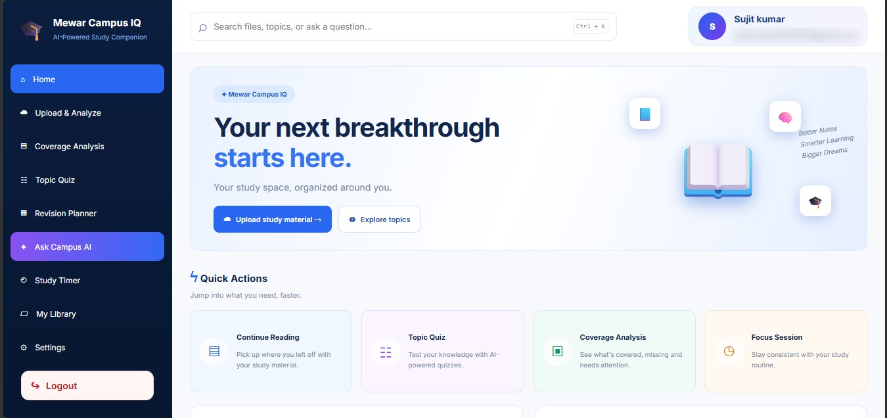
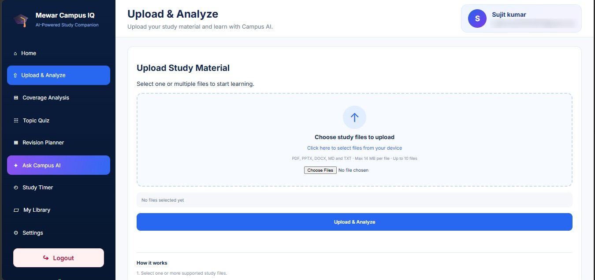
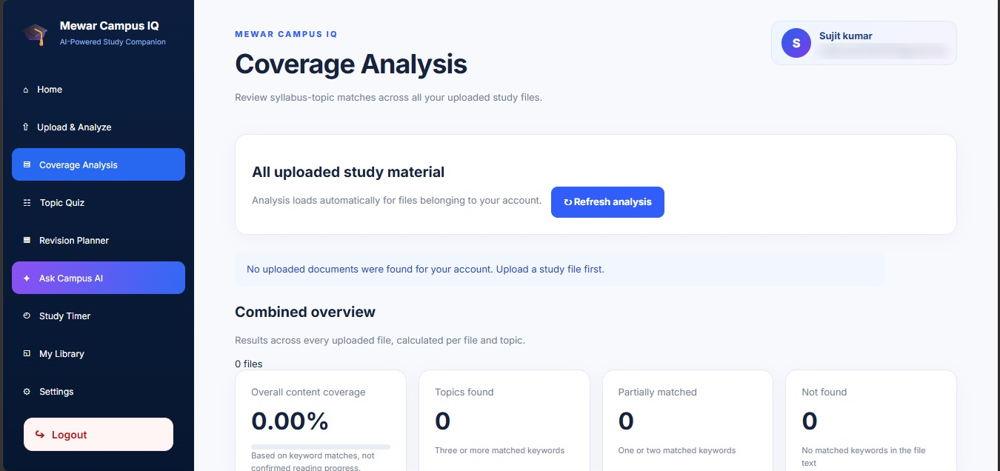
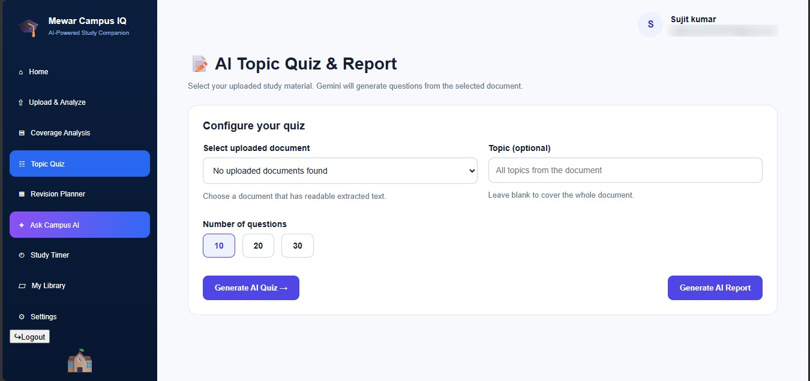
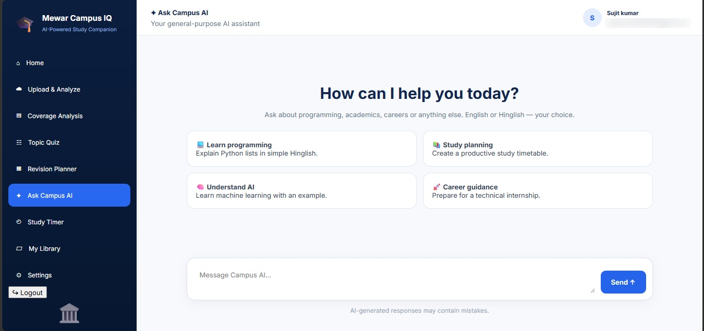

<div align="center">

# Mewar Campus IQ 🎓🤖

**An AI-powered study companion for students.**
Upload study material, track syllabus coverage, practice AI-generated quizzes and get instant help from Campus AI, all in one place.


🌐 **[Live Demo](https://mewar-campus-iq.onrender.com)** &nbsp;|&nbsp; 📦 **[GitHub Repository](https://github.com/sujitkumar419/Mewar-Compus-IQ)**

**MU Hackathon 2026 · Theme: Smart Campus · Team Mewar Innovators**

</div>

---

## Table of Contents

- [Overview](#overview)
- [Problem Statement](#problem-statement)
- [Our Solution](#our-solution)
- [Features](#features)
- [Screenshots](#screenshots)
- [Technology Stack](#technology-stack)
- [Architecture](#architecture)
- [Project Structure](#project-structure)
- [Local Setup](#local-setup)
- [Environment Variables](#environment-variables)
- [API Endpoints](#api-endpoints)
- [Deployment](#deployment)
- [Troubleshooting](#troubleshooting)
- [Limitations](#limitations)
- [Future Scope](#future-scope)
- [Team](#team)

---

## Overview

**Mewar Campus IQ** is a web-based study companion built for the **MU Hackathon 2026** (Smart Campus theme) at Mewar University. Instead of only storing notes, it brings study-material upload, syllabus coverage analysis, AI quizzes and an AI assistant (**Campus AI**) into a single application.

The project was designed, built and deployed in about two weeks, starting 2 October 2026, and our team presented a live demo to the judges and reached Round 2.

> **Status:** Deployed prototype. AI response time depends on the hosting platform and the availability and limits of the Gemini API.

## Problem Statement

> Scattered study material, untracked syllabus coverage and no personalized support make revision inefficient and hurt exam readiness.

| # | Root cause | Impact |
|---|-----------|--------|
| 1 | Notes and documents are scattered across files and formats | Slow, inefficient revision |
| 2 | No centralized system to track syllabus coverage | Missing topics go unnoticed |
| 3 | No personalized guidance or instant doubt-solving | Low confidence before exams |

## Our Solution

Mewar Campus IQ combines a Flask web application, PDF/document text extraction, a coverage-analysis module and the Google Gemini API:

1. The student uploads notes and syllabus files.
2. The extractor reads the text and the coverage module matches it with syllabus topics.
3. Campus AI generates quizzes, summaries and answers from that material.
4. The dashboard shows everything in one place.

## Features

- **Upload & Analyze:** upload PDF, PPTX, DOCX, MD and TXT files (up to 10 files, max 14 MB each).
- **Coverage Analysis:** topic-wise results based on keyword matches. Three or more matches count as *found*, one or two as *partial*, none as *missing*.
- **Topic Quiz:** generate AI quizzes of 10, 20 or 30 questions from an uploaded document, with an optional topic filter and an AI report.
- **Ask Campus AI:** a general-purpose AI assistant that answers in English or Hinglish.
- **Revision Planner:** plan revision around weak topics.
- **Study Timer:** focus sessions for consistent study.
- **My Library:** saved study material in one place.
- **Authentication:** login and sign-up flows, with each student's files tied to their own account.

## Screenshots

<table>
  <tr>
    <td align="center"><br><b>Dashboard</b></td>
    <td align="center"><br><b>Upload &amp; Analyze</b></td>
  </tr>
  <tr>
    <td align="center"><br><b>Coverage Analysis</b></td>
    <td align="center"><br><b>AI Topic Quiz</b></td>
  </tr>
  <tr>
    <td align="center" colspan="2"><br><b>Ask Campus AI</b></td>
  </tr>
</table>

## Technology Stack

| Layer | Technology | Purpose |
|-------|-----------|---------|
| Backend | Python, Flask | Web server, routing, request handling |
| Frontend | HTML, CSS, JavaScript | Pages, styling, browser interactions |
| AI | Google Gemini API | Quizzes, answers and learning assistance |
| Text extraction | PyMuPDF, PyPDF | Reading text from uploaded files |
| Database | PostgreSQL (Supabase) | Persistent data storage |
| Packaging | Docker | Reproducible deployment |
| Hosting | Render | Public cloud deployment |
| Version control | Git, GitHub | Source control and collaboration |

> The exact package versions are defined in `requirements.txt`.

## Architecture

```text
Upload  ->  Extractor  ->  Coverage Analysis  ->  Campus AI  ->  Dashboard
```

```text
Student's browser
      |  HTTP request / form submission
      v
Flask application (app.py)
      |
      +--> HTML templates + CSS / JavaScript assets
      +--> Text extraction (PyMuPDF / PyPDF)
      +--> Coverage analysis module
      +--> Gemini API (quizzes, chat)
      +--> Supabase PostgreSQL
      v
Response rendered in the browser
```

## Project Structure

```text
Mewar-Compus-IQ/
├── app.py              # Flask application and routes
├── config.py           # Application configuration
├── pdf_reader.py       # Text-extraction utility
├── requirements.txt    # Python dependencies
├── Dockerfile          # Container build instructions
├── campus_iq/          # Supporting application code
├── static/
│   ├── css/            # Stylesheets
│   ├── js/             # Browser-side JavaScript
│   └── images/         # Images and visual assets
├── templates/          # Flask / Jinja HTML templates
├── docs/               # Documentation
├── dashboard.png ...   # README screenshots (5 images)
├── tests/              # Tests
└── uploads/            # Local upload directory
```

The exact layout may change as features are added. Inspect the repository for the current structure.

## Local Setup

**Prerequisites:** Python, Git, a Google Gemini API key and PostgreSQL (Supabase) connection details. Docker is optional.

```bash
# 1. Clone the repository
git clone https://github.com/sujitkumar419/Mewar-Compus-IQ.git
cd Mewar-Compus-IQ

# 2. Create and activate a virtual environment
python -m venv venv
# Windows (PowerShell):  .\venv\Scripts\Activate.ps1
# macOS / Linux:         source venv/bin/activate

# 3. Install dependencies
pip install -r requirements.txt

# 4. Create a .env file (see below), then run
python app.py
```

Open the URL printed in the terminal (usually `http://127.0.0.1:5000`).

## Environment Variables

Create a local `.env` file. **Never commit it.** Confirm the exact variable names in `app.py` and `config.py`.

```env
GEMINI_API_KEY=your_gemini_api_key
DATABASE_URL=your_postgresql_connection_string
```

On Render, add these under the service's **Environment** settings. Keep API keys and database passwords out of source code, screenshots and logs.

## API Endpoints

| Endpoint | Purpose |
|----------|---------|
| `GET/POST /login` | Login page and handling |
| `GET/POST /signup` | Registration page and handling |
| `GET /topic-quiz` | Quiz page |
| `POST /api/quiz/generate` | Generate a quiz |
| `POST /api/quiz/submit` | Submit quiz answers |
| `POST /api/ask` | Ask Campus AI a question |
| `POST /api/pdf/upload` | Upload and process a file |
| `GET /api/health` | Health check |

Check `app.py` for exact methods, authentication rules and response formats.

## Deployment

The app is hosted on **Render** and packaged with **Docker**.

1. Push tested code to GitHub.
2. Connect the repository to a Render web service.
3. Add the required environment variables.
4. Deploy, then check `/api/health` and the Render logs.

> Render runs on Linux, where file paths are case-sensitive. Keep `static/css/` and `static/js/` paths identical in templates and in Git.

## Troubleshooting

- **App does not start:** read the Render build and runtime logs, and check `requirements.txt` and environment variables.
- **CSS or JS missing:** open the asset URL directly, check for 404s and path capitalization, then hard refresh (`Ctrl + F5`).
- **AI request fails:** check the API key, model name, quota and provider status.
- **Upload fails:** use a small text-based file and check the type and size limits.
- **First load is slow:** on a free Render plan the service sleeps when idle, so the first request can take up to a minute.

## Limitations

- Scanned or image-only PDFs may not work because OCR is not implemented yet.
- Coverage analysis is based on keyword matching, not on confirmed reading progress.
- AI answers can contain mistakes, so verify important information against course material.
- Features depend on the availability and limits of Gemini, Supabase and Render.

## Future Scope

- OCR for scanned documents
- Advanced analytics for students and faculty
- AI-driven personalized study plans
- Cloud scaling for campus-wide rollout

## Team

**Team Mewar Innovators** · MU Hackathon 2026, Mewar University

| Name | Course |
|------|--------|
| [Sujit Kumar](https://github.com/sujitkumar419) | B.Tech CSE |
| Vishal Kumar | B.Tech CSE |
| [MD Salman Khan](https://github.com/MDSalman22415) | BCA |

Thanks to Mewar University for the opportunity.

---

<div align="center">

If you find this project useful, please give it a ⭐

</div>
